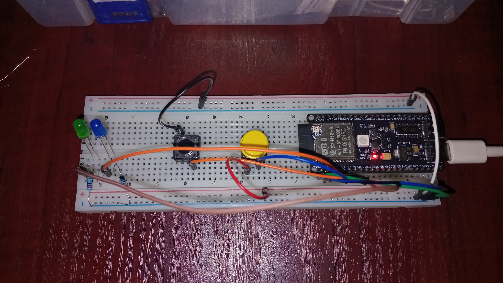

# ESP32-S3-Internal-Pullup-Pulldown
# ESP32-S3 Internal Pull-up and Pull-down Resistors

## Overview

This project demonstrates how to use the ESP32-S3's built-in internal pull-up and pull-down resistors to read digital inputs from two push buttons and control two LEDs.

The project was physically assembled and tested using an ESP32-S3 development board.

## Hardware Requirements

* ESP32-S3 N16R8 Development Board
* 2 Push Buttons
* 2 LEDs
* Breadboard
* Jumper Wires

## GPIO Configuration

| Component        | GPIO   | Configuration  |
| ---------------- | ------ | -------------- |
| Pull-down Button | GPIO 5 | INPUT_PULLDOWN |
| Pull-up Button   | GPIO 6 | INPUT_PULLUP   |
| Pull-down LED    | GPIO 7 | OUTPUT         |
| Pull-up LED      | GPIO 4 | OUTPUT         |

## How It Works

### Internal Pull-down (GPIO 5)

The push button connects GPIO 5 to 3.3V when pressed.

* Button pressed: HIGH
* Button released: LOW

### Internal Pull-up (GPIO 6)

The push button connects GPIO 6 to GND when pressed.

* Button pressed: LOW
* Button released: HIGH

Each button independently controls its corresponding LED.

## Learning Objectives

Through this project, I explored:

* Digital input and output configuration.
* Internal GPIO pull-up and pull-down resistors.
* Digital signal reading.
* Conditional logic using if/else statements.
* Serial communication and debugging.
* Physical circuit construction and testing.

### Circuit Overview

## Purpose

This project is part of my self-directed learning journey in embedded systems and microcontroller programming.

My objective is to develop a strong foundation in electronics, C/C++ programming, GPIO control and hardware-software interaction as preparation for more advanced embedded systems, robotics and IoT projects.

**Author:** T5H3P4N9

